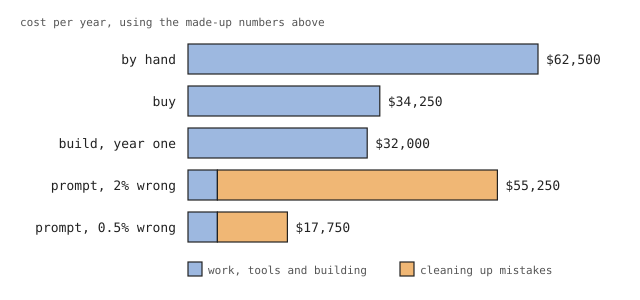

In [No Free Lunch](/no-free-lunch/), I did some back-of-the-envelope math to show that buying lunch for engineers pays for itself. The numbers were rough, but the exercise was useful, because it turned an argument about perks into an argument about dollars. I think the same exercise is overdue for AI tools. Teams used to ask whether they should build something or buy it, and now there's a third option, which is to hand the job to a model. Let's do the math on all three.

## The setup

All of the numbers below are made up for easy math, so please swap in your own. Let's say that a team handles 100 requests a day (support tickets to sort, invoices to enter, whatever it happens to be), and each one takes a person about a minute and a half. That's 150 minutes, or 2.5 hours a day. Over 250 working days, it comes out to 625 hours a year.

Let's also say that an hour of someone's time costs the company $100, once salary, benefits and overhead are included. So, the task costs $62,500 a year to do by hand. That's the number that any tool has to beat.

## Buy

If someone already sells a product that does this, buying it is usually the cheapest option on paper. Let's say it's $50 a month per person for five people, or $3,000 a year. Even if it only removes half of the work, that's $31,250 saved for $3,000 spent.

The costs that don't show up on the pricing page are the ones to look for. A product is built for the average customer, so the team has to bend its process to fit the tool. There's also the time to set it up, the time to move the data in, and the cost of getting the data back out if the vendor raises the price or shuts down. For a problem that plenty of other companies have, these are usually worth paying. For a problem that's specific to your business, they add up quickly.

## Build

The traditional alternative is to write the software ourselves, with plain code and clear rules. Let's say it takes two engineers four weeks. That's 320 hours, or $32,000, plus something like 20% a year to keep it running.

In return, we get something that fits the process exactly, costs almost nothing per request, and gives the same answer every time. If the rules for the task can be written down, this is still a very good deal -- it pays for itself in about six months, and it never has a bad day. The catch is the "if". Plenty of tasks have rules that nobody can quite write down, which is the reason a person was doing them in the first place.

## Prompt

The third option is to have a model do the task. The build is much smaller, since most of the logic is a prompt instead of code. Let's say it takes one engineer a week, or $4,000. The model charges for every request, so let's say 5 cents each. For 25,000 requests a year, that's $1,250.

So far, this looks like the obvious winner: $5,250 to save $62,500. This is usually where the math stops, and it's also where it goes wrong, because it leaves out the line that matters the most. A model is going to get some of the requests wrong, and every wrong answer costs something to notice and clean up.

Let's say that a mistake takes an hour to sort out, between the confused customer, the person who tracks it down, and the fix. If the model is wrong 2% of the time, that's 500 mistakes a year, or $50,000. The total cost is now $55,250 against $62,500 saved, and we've taken on a lot of risk to save about $7,000.

If the model is wrong 0.5% of the time, the mistakes cost $12,500, and the tool saves about $45,000 a year. That's a great result!

The difference between a tool that's barely worth having and a tool that's a great investment is a point and a half of error rate. The price of the model hardly matters by comparison. This is why I keep going on about [evals](/evals-are-just-tests/): without them, the most important number in the calculation is a guess.

To be fair, people make mistakes too, and the by-hand number above should really include them. It's worth measuring how often that happens before deciding that 2% is unacceptable. Most teams don't know their own error rate, either.

## How I'd decide

Given all of that, here's how I'd approach it.

If someone sells a tool for the problem, and the problem isn't special to your business, buy it. If the rules can be written down, build it with plain code, since it's free to run and it doesn't make mistakes that it didn't make yesterday. If the task needs judgment and a mistake is cheap to fix, a model is a very good fit. If the task needs judgment and a mistake is expensive, a model can still work, but the plan needs to include a person checking the output, and their time goes into the math.

In practice, the best answer is often a mix. Plain code handles the cases with clear rules, a model handles the fuzzy ones, and a person looks at the ones that the model isn't sure about.

The saying goes that there's no free lunch, and a model is no exception -- the cost has moved from the building to the being wrong. I'd recommend that anyone pitching an AI tool to their team bring this math along, with an honest number on the mistakes line. If it still comes out ahead, it's an easy decision.
