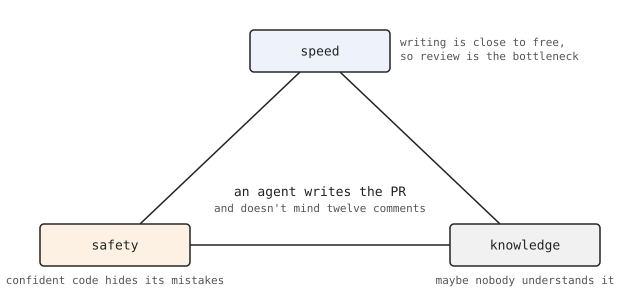

Back when I wrote about [Code Review](/code-review/), one of the main points was that a lot of the value isn't from the review itself; it's from the fact that developers know they need to send their code past others. That point has aged in an interesting way. A coding agent doesn't feel any pressure from its reviewer, and it doesn't mind if you leave twelve comments on its PR. It will happily open a 2,000-line pull request in the middle of the night and wait for someone to read it.

In that post, I talked about balancing three perspectives in a code review process: speed, safety, and knowledge dissemination. All three change when a good chunk of the code is written by a model, so let's go through them one at a time.



## Speed

Writing code used to be the slow part, and review was the (sometimes annoying) cost on top of it. Now, writing the code is close to free, and review is the bottleneck. If your team picks up an agent and suddenly has three times as many PRs, you haven't tripled your output -- you've tripled the amount of reading your senior engineers have to do. I suspect this is where a lot of teams start skimming, and "LGTM" becomes the default answer.

I think that's the wrong tradeoff. If anything, the time saved writing code should go into reading it. A team that writes code three times as fast and reviews it half as carefully is very likely to end up worse off once the bugs start coming in.

## Safety

Model-written code also fails differently than human-written code. When a person doesn't fully understand what they're doing, the code usually shows it: it's a bit awkward, there's a TODO, or the PR description says "not sure about this part." A model writes code that looks confident whether it's right or not. That means the gut check from the original post ("does anything look off?") doesn't work nearly as well, since nothing looks off!

On top of the usual review, here's what I've started checking for:

- Does it solve the problem that was asked, or a similar, easier one? Models are very good at solving a slightly different version of your problem, so it's worth re-reading the ticket before reading the diff.
- Are the tests actually testing anything? An agent that's been asked to make the tests pass will sometimes make the tests easier instead of making the code correct. Look for loosened assertions, skipped cases, and mocks that return exactly what the test expects.
- Does everything it uses actually exist? Made-up functions and config options are rarer than they used to be, but they still show up.
- Does it match the rest of the codebase? A model will often solve a problem in a perfectly reasonable way that's different from how your team solved the same problem everywhere else. That's a [Principle of Least Surprise](/principle-of-least-surprise/) problem, and it adds up quickly.
- Is there more code than the problem needs? Generated code tends towards extra abstraction, extra error handling, and comments that explain what the next line does. Ask for the smaller version.

## Knowledge Dissemination

This is the one I worry about most. When a person writes a feature, at least one person understands it. When an agent writes a feature and a reviewer skims it, it's very possible that _nobody_ does. Six months later, something breaks in production, someone sits down to write the [RCA](/rca-and-no-blame-culture/), and there's no one to ask why it was built that way.

My rule from the original post still applies: _at least one other person_ should read all of the code that goes into the codebase -- no exceptions. I'd go a step further now, though. The person who prompted the agent is the author, and they own the PR exactly the same as if they had typed it themselves. They should do a full self-review before asking anyone else to look, and they should be able to explain every line when asked. If they can't, it's not ready for review.

A couple of other things have helped me here. Keep PRs small (ask the agent for one change at a time, instead of the whole feature at once), and put the prompt or plan in the PR description, so the reviewer knows what the agent was asked to do and can spot where it drifted. It doesn't need to be long. Something like this is plenty:

```
## What I asked for
Add a CSV export to the invoices page, using the existing export helper.

## Where the agent went its own way
It wrote a new date formatter. I replaced it with the one in utils/dates.

## What I checked by hand
Exported three real invoices, opened them in a spreadsheet, and compared the totals.
```

The middle section is the one I'd insist on. It tells the reviewer where to look first, and writing it forces the author to actually find those spots before anyone else does.

AI reviewers are also pretty good at a first pass for typos and missed edge cases, but I don't treat them as the last reader. And of course, the more your [lint](/strict-linting/) and tests catch automatically, the more attention the human reviewer has left for the stuff that matters.

Overall, I think code review matters even more now than it did when I first wrote about it. The code got a lot cheaper, but understanding it didn't, and that understanding is still what a team is actually paid for.
