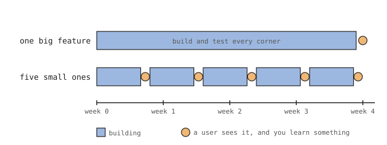

I mentor engineers, and the question I get asked the most these days is some version of "how do I deliver impact in an AI world?" It's a fair thing to worry about. If an agent can write the code, then being the person who writes good code isn't as much of an advantage as it used to be, and it's not obvious what replaces it.

My answer has changed over the last few years, and it's changed in a way that might be surprising if you've read the older posts on this site. I used to push hard for thorough test coverage. These days, I mostly give advice around velocity.

## What I used to say

In the [Testing](/testing/) post, there's a thought experiment: imagine that we have perfect tests that complete instantly. We can then make a very small change, run the tests, undo the change if they fail, and repeat. The more we test, the closer we get to that workflow, and the faster and more confidently we can make changes.

I still think that's right. However, it's worth noticing what the argument is actually for. Coverage was never the goal in that post. The goal was being able to change the software quickly without being afraid of it, and thorough tests were the best way we had of getting there.

## What changed

Code used to be expensive to write. If we shipped the wrong thing, we had spent a week or two on it, and fixing it was going to cost another week. With costs like that, it made sense to put a lot of effort into being correct the first time, and to test every corner before anything went out.

Now, the first version of a feature takes an afternoon, and so does the second version. When being wrong is that cheap to fix, the math changes -- an extra week spent on being thorough costs a lot more than it used to, in terms of what we could have shipped and learned in that week. Working code is no longer the hard part to come by. The hard part is finding out whether the code was worth writing, and the only way to find that out is to put it in front of the people who use it.

So, when a mentee asks about impact, I tell them to optimize for how quickly they can get something real in front of a user, see what happens, and go again. An engineer who ships five small things and learns from each of them is very likely to end up further along than one who ships a single, perfectly covered thing that turns out to be the wrong feature.

The difference between those two isn't really the amount of code. They wrote about the same amount. The difference is how many times each of them found out whether they were right. The first engineer gets one answer, at the end of the month, and if it's the wrong feature, the whole month goes with it. The second gets five answers, and each one steers the next.

## What velocity doesn't mean

Like everything, this has tradeoffs, and I try to be clear with mentees about where it stops.

It doesn't mean shipping code you don't understand. As I covered in [Code Review for AI-Written Code](/code-review-for-ai-written-code/), the person who prompted the agent owns the result, and that hasn't changed. Moving fast only works if you can tell when something is wrong.

It also doesn't mean no tests. It means being picky about which ones. Anything where a mistake is expensive or can't be taken back -- money, people's data, anything safety-related -- still deserves the full treatment. So does a bug that has already happened once, since a test is the cheapest way to make sure it doesn't happen twice. What I've stopped recommending is chasing complete coverage up front on a feature that might be rewritten or deleted next week.

Finally, it depends on being able to recover quickly. Small changes, fast deploys, and an easy way to roll back are what make it safe to be wrong. If a release takes two weeks to go out, then it's worth slowing down and testing more, because a mistake is going to sit there for two weeks.

## My recommendation

If you're trying to figure out where you fit now, I suggest measuring yourself by what changed for the user, and not by how much code went in. Pick problems that are close to a real person, ship the smallest version that they can react to, and pay attention to what they do with it. The engineers who do that well were valuable before AI, and from what I can tell, they're even more valuable now.

For what it's worth, this is most of what I work on with mentees. If you'd like to talk it through, you can find me on [MentorCruise](https://mentorcruise.com/mentor/aaronbuxbaum/).
