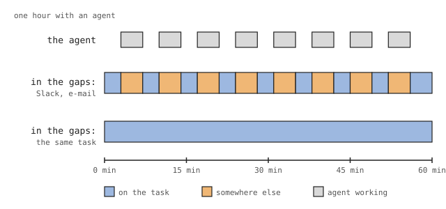

In [Focus and Flow](/focus-and-flow/), I wrote about the tradeoffs between a flow state and the Pomodoro technique, and about how much of a knowledge worker's day gets eaten by shallow work that only _feels_ productive. The first tip on the list was to turn off your notifications.

That post assumed that the programmer was the one doing the programming. These days, a lot of the work looks different: I describe a task, an agent goes off and works on it for a few minutes, and then it comes back with a result or a question. That changes what a focused session looks like, and I think it creates a few new ways to lose focus that are worth talking about.

## The waiting problem

The first one is the wait. An agent takes long enough that watching it is boring, and not long enough to get anything substantial done in the meantime. The natural thing to do with a three-minute gap is to check Slack or e-mail, and by the time the agent is done, my attention is somewhere else entirely. It's the same problem I described with the break between Pomodoros, where my motivation has "reset" along with the break -- except that it now happens many times an hour.

## The notification problem

The second one is that the agent is, itself, a notification. In the original post, I mentioned Cal Newport's point from "Deep Work" about why e-mail is addictive: you don't know what might be sitting in your inbox, and checking it gives the brain a tiny dopamine hit. An agent that's working in the background has exactly the same shape. It might be done, it might have a question, or it might have produced something great, and there's only one way to find out. If the agent also dings or bounces an icon when it wants approval, then I've turned my notifications back on without really deciding to.

## The parallel problem

The third one is running several agents at once. It's very tempting, since each of them is mostly waiting on me anyway, and having four tasks in progress feels like four times the output. In practice, it's the definition of shallow work. Every time I switch from one agent to another, I have to reload what that task was about, and I end up skimming each result instead of reading it. Flow state, at least, had the advantage that it was deep. This has the constant switching of a busy Slack day, with the added risk that the code gets merged.

The original post also pointed out that engineers sometimes "flow" for a full day or more on a concept that was poorly thought out from the beginning. Agents do this too, and they do it a lot faster. An agent with a bad plan will produce a great deal of work in an hour, and all of it has to be read before it can be thrown away.

## What I suggest

Here are the tips that I'd add to the original list:

1. Turn off the agent's notifications, too. Sounds, badges, and bouncing icons from an agent are no different from the ones from Slack. Check on it when you've decided to, and not when it asks.
2. Decide what the agent is doing before the session starts. The Pomodoro technique works because there's a single goal at the beginning. Write the task down in enough detail that the agent can run for a while without coming back with questions. Time spent on the plan is almost always cheaper than time spent on interruptions.
3. Have a job for the gap. While the agent works, do something that belongs to the same task: read the diff from the last step, write down the cases the result needs to handle, or think about what comes next. Checking e-mail is not part of the task, so it doesn't belong in the gap either.
4. Limit how many agents are running. I suggest one task that has your real attention, and at most one more that's mechanical enough to review quickly (a rename, a lint cleanup, a dependency bump). If you find yourself skimming results, that's a sign there are too many.
5. Batch the reviews. Reading generated code carefully is deep work, and it deserves its own session with nothing else running. Trying to review in the gaps between prompts is how things get approved without being read.
6. Give the agent permission to do the boring parts without asking. Most tools let you decide which actions need approval. If it asks before every file read or test run, you'll be interrupted constantly, and you'll start approving without looking. Keep the approvals for the things that matter, such as anything that deletes, deploys, or sends.
7. Check the direction early. Look at the first few minutes of the agent's work before letting it run for an hour. If the approach is wrong, it's much cheaper to find out before there's a thousand lines of it.
8. Still take the break. When the timer goes off, step away, even if the agent is in the middle of something. It will be exactly where you left it.

Overall, I think the advice from the original post still holds, and the agent is one more thing it needs to be applied to. Our attention is still the limited resource. If anything, it matters more than it did, since so much of the job is now reading and deciding, and both of those are hard to do well while distracted.
