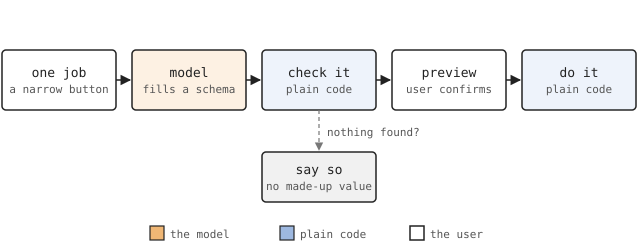

A few years ago, I wrote about the [Principle of Least Surprise](/principle-of-least-surprise/), which says that a user should be able to reasonably guess the result of an action before they take it. At the time, I was mostly talking about code (function names, return values, JavaScript's `parseInt` defaulting to base 8, and so on). Now that so many products are being built on top of language models, I think it's worth coming back to, because a language model is pretty much a surprise generator by design.

> If a necessary feature has a high astonishment factor, it may be necessary to redesign the feature.

For whatever reason, most AI features I see today seem to be built for the demo. You type a sentence in, something impressive comes out, and everyone in the meeting is excited. That's fine for a pitch, but the person using the tool every day has a different problem -- they need to know what's going to happen when they press the button. The first time the output is surprising, it's fun. By the tenth time, it's a reason to stop trusting the tool, and once a user stops trusting the tool, they go back to doing it by hand.

## Why this is harder with a model

With normal code, a surprise is usually just a bug or a bad API. We find it, fix it, write a test, and it doesn't happen again. With a model in the loop, some amount of surprise is going to be there no matter what we do: the same input can give a different output on the next run, a model upgrade can change the tone of every response, and a prompt that worked great on our test cases can do something strange the first time a real user pastes in a messy spreadsheet.

This doesn't mean you can't build a predictable product on top of an unpredictable part -- we already do that with networks, hard drives and people! It does mean that predictability has to be designed in on purpose, because it's not going to show up on its own.

## What I do about it

There's no single trick here, but a few things have made the biggest difference for me.

First, I keep the job narrow. An "ask me anything" box is the most surprising interface you can build, since the user has no way of knowing what will work. A button that says "Summarize this thread" sets an expectation the user can actually check. It's tempting to build the general version first because it demos better, but I've had much better luck starting narrow and widening it once people ask for more.

Second, I show the work before doing the work. If the tool is going to change something (send an email, edit a file, update a record), it should show what it's about to do and let the user confirm. A diff is a lot less surprising than a finished result, and it's much easier to check. For example, "Done! I updated 14 records" is a surprise, even when it's right. "This will change the owner on these 14 records", with the list and a button, is not.

Third, I try to get the model to fill in a shape instead of writing a paragraph. If the output is a table, a form, or a single field, the user can scan it in a second, and the model has a lot less room to wander. Most model APIs support structured output now, so this is usually as simple as passing a schema:

```
const schema = {
  type: "object",
  properties: {
    dueDate: { type: ["string", "null"], format: "date" },
    owner: { type: ["string", "null"] },
  },
  required: ["dueDate", "owner"],
};
```

Note the `null`s. This leads into the fourth point: when the model can't find something, it should say so. "We couldn't find a due date in this document" is far better than a made-up due date, and giving the model an explicit way to say "I don't know" goes a long way.

Put together, the model ends up with a pretty small job. It fills in the shape, and plain code does everything around it: checking what came back, showing the preview, and making the actual change.



Finally, I test for consistency and not only for correctness. I run the same input through a feature a few dozen times and look at the spread of the results. If a user would be surprised by the difference between two runs, I treat it as a bug, even if both answers are technically right. This doesn't take anything fancy:

```
const outputs = new Map();

for (let i = 0; i < 30; i++) {
  const result = JSON.stringify(await extractFields(input));
  outputs.set(result, (outputs.get(result) ?? 0) + 1);
}

console.log(outputs);
```

If the map has one entry, great. If it has five, then a user who runs the same document twice is going to see two different answers, and that's exactly the kind of surprise that sends people back to doing it by hand. Anything the user relies on being the same every time (formatting, units, which account gets charged) should be plain old code and not left up to the model at all.

## The demo is the easy part

When I wrote about [Apollo GraphQL](/why-apollo-graphql-is-slow/), the point was that new technology tends to get described as entirely Good, and the tradeoffs don't show up until you're using it at scale. AI is the same pattern with a much bigger marketing budget. Getting a model to do something impressive once is relatively easy. Getting it to do the same unimpressive thing reliably, for a tired person on a Tuesday afternoon, is where most of the work is.

For what it's worth, that's most of what I do at [Pseudorandom](/pseudorandom/). If you're building something with AI and it still feels a little too magical, I'd be happy to talk!
