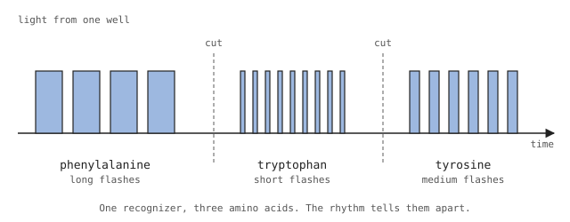

This week, a paper that I'm an author on was published in _Science_: [Real-time dynamic single-molecule protein sequencing on an integrated semiconductor device](https://www.science.org/doi/full/10.1126/science.abo7651). It comes out of Quantum-Si, a company that builds a benchtop machine for sequencing proteins. There are around eighty authors on it, and I did much of the software engineering.

I'm not a biochemist, and the paper is not light reading, but I think it's a great example of what software looks like when it's one part of a much larger piece of science. So, here's my attempt at explaining it for people who write code for a living.

## Why proteins

DNA sequencing has become cheap and routine, and it has changed a lot about how biology is done. The trouble is that DNA is closer to the plan than to the result. Proteins are what actually do the work in a cell, and which proteins are present (and how they've been modified) isn't something that can be fully read off of the genome.

Proteins are also much harder to sequence. There are twenty amino acids to tell apart instead of four bases. A cell has well over 10,000 different proteins, in amounts that vary enormously. Worst of all, proteins can't be copied. A lot of DNA sequencing depends on making many copies of a molecule so that there's enough signal to read, and there's no equivalent trick for a protein. If we want to read one, we have to be able to see a single molecule.

## How it works

The approach in the paper starts by cutting proteins into shorter pieces, called peptides, and anchoring each one at the bottom of a tiny well on a semiconductor chip. Then, two kinds of molecules are added to the liquid above them.

The first kind are _recognizers_. These are proteins that have been engineered to grab onto whichever amino acid is at the exposed end of a peptide, and each one carries a fluorescent dye. A recognizer doesn't grab on and stay there. It binds, lets go, and binds again, over and over, and the chip sees a flash of light each time.

The second kind are _aminopeptidases_, which are enzymes that cut the end amino acid off of the peptide. Every so often one of them does its job, a new amino acid is exposed, and the pattern of flashes changes.

What I find clever is where the information comes from. One recognizer can bind to several different amino acids, but it holds on to each of them for a different amount of time. For one of the recognizers in the paper, a typical flash lasted about 2.5 seconds on phenylalanine, 0.7 seconds on tyrosine, and 0.3 seconds on tryptophan. So, the identity of the amino acid is in the rhythm of the flashing, and not only in which dye is lit up.

The chip itself is just as unusual. Most instruments tell dyes apart by color, which needs optical filters. This one tells them apart by timing: after each pulse of the laser, a dye keeps glowing for a few nanoseconds, and different dyes fade at different rates. The chip measures how much light arrives early versus late after each pulse, and that ratio identifies the dye. Since it's timing the light anyway, it can also ignore the laser itself, which is what lets all of this fit on a chip in a box that sits on a bench.

## Where the software comes in

From a software point of view, the output of all of that chemistry and physics is a very large number of noisy time series: one signal for every well on the chip, recorded over a run that lasts for hours. None of them say "leucine". Getting from there to a sequence takes a few steps, which the paper describes in its methods.

First, the flashes have to be found. For each well, the software estimates what the background noise looks like, and then watches the signal as it comes in, deciding at each point whether it's looking at background or at a pulse. The background drifts over the course of a run, so that estimate has to keep updating as it goes.

Second, the pulses have to be grouped into segments. As long as the same amino acid is at the end of the peptide, the pulses look statistically alike: similar durations, similar gaps, similar brightness, and the same dye. When an amino acid is cut off, those statistics shift. The software looks for the points in time where the pulses before and after are significantly different from each other, and splits the signal there.

Third, each segment has to be identified, based on its dye and its pulse durations, and the sequence of segments has to be matched against the peptides that it could have come from.

If you've read my posts on [testing](/testing/), you can probably guess what I think the hard part is. In most software, there's a right answer, and a test can check for it. Here, the input is physical. Every well is a little different, single molecules behave randomly (the paper points out that each one gets cut at different times, so no two signals line up), and "correct" is a statistical statement about thousands of wells. A test for software like this can't simply assert on an answer, and has to ask whether the results across many wells fall within the range that we expect.

## What it shows, and what it doesn't

The paper shows that the method can read peptides of different lengths and compositions, tell apart two peptides that differ by a single amino acid, detect some chemical modifications, pick out peptides from a mixture, and read peptides cut from real human proteins.

It's also upfront about the limits. For now, the recognizers cover seven of the twenty amino acids, which make up about 36.5% of the amino acids in human proteins. That's less of a problem than it sounds like, since most uses only need enough of a pattern to match against a list of known proteins, and the paper estimates that 96.7% of human proteins contain at least one peptide that could be mapped that way. Still, reading every amino acid in an unknown protein is left as future work.

## What I took from it

What stands out to me is how much of modern science is software. The chemistry and the chip are what make the measurement possible, and I can't take any credit for those. However, the instrument doesn't produce an answer. It produces a signal, and everything between that signal and a result a scientist can use is code that someone has to write, test, and keep running.

For what it's worth, I'd recommend that kind of work to any software engineer who gets the chance. Being the person in the room who knows the least about the subject is uncomfortable, and it's also a very good way to learn.
