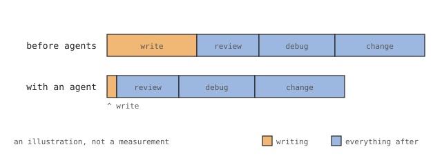

> "Simplicity is a great virtue but it requires hard work to achieve it and education to appreciate it. And to make matters worse: complexity sells better."
> _Edsger Dijkstra_

I've had this quote saved for years, along with a few others from Dijkstra, with the intention of writing something about simplicity. I never got around to it, mostly because it felt like there wasn't much to add. Everyone agrees that simple code is better, and then everyone goes back to work and writes something complicated.

I think it's worth finishing now, because the economics around the quote have changed. Dijkstra's point was that simplicity is expensive: it takes hard work to get there. What kept complexity somewhat in check was that it took work, too. Somebody had to type out the extra layer of abstraction, the configuration system, and the six classes where one function would have done. That work is now close to free.

## Complexity got cheap

Ask a coding agent for a small feature, and there's a good chance that it comes back with more than was asked for. There will be error handling for cases that can't happen, options that nobody requested, and a helper module for something that's used once. None of it is wrong, exactly. It all looks careful and professional, which is the problem.

Here's the kind of thing I mean. Ask for a function that formats a price, and it's common to get back something like this:

```
type FormatPriceOptions = {
  currency?: string;
  locale?: string;
  fallback?: string;
};

export function formatPrice(
  cents: number | null | undefined,
  options: FormatPriceOptions = {},
) {
  const { currency = "USD", locale = "en-US", fallback = "-" } = options;

 if (cents === null || cents === undefined || Number.isNaN(cents)) {
    return fallback;
  }

 try {
    return new Intl.NumberFormat(locale, { style: "currency", currency }).format(cents / 100);
  } catch (error) {
    console.error("Failed to format price", error);
    return fallback;
  }
}
```

If every price in the app is a number of cents in US dollars, this is the whole job:

```
const usd = new Intl.NumberFormat("en-US", { style: "currency", currency: "USD" });

export const formatPrice = (cents: number) => usd.format(cents / 100);
```

The first version isn't wrong. It has three options that nobody asked for, a check for a `null` that no caller ever passes, and a `try` around an error that only shows up for a currency code we never pass. Each of those is something that a reviewer has to read, and that the next change has to keep working.

> "There are two ways of constructing a software design: one way is to make it so simple that there are obviously no deficiencies, and the other way is to make it so complicated that there are no obvious deficiencies."
> _Tony Hoare_

Hoare said that in 1980, and I can't think of a better description of generated code. As I mentioned in [Code Review for AI-Written Code](/code-review-for-ai-written-code/), a model writes code that looks confident whether it's right or not. Code with no _obvious_ deficiencies is what it produces by default. Getting to code that obviously has none still takes the hard work that Dijkstra was talking about, and that work hasn't gotten any cheaper.

The second half of his quote has aged well, too. Complexity still sells better. A demo with twelve features is more impressive than a demo with three, and a 2,000-line pull request looks like more got done than a 200-line one. When the larger version costs the same to produce as the smaller one, it's very hard to argue for the smaller one in a meeting.

## Why it still matters

> "Simplicity is prerequisite for reliability."
> _Edsger Dijkstra_

The cost of complexity was never really in the writing. It's in everything that comes afterwards: every line has to be read by a reviewer, understood by whoever debugs it, and worked around by whoever changes it next. Those costs haven't moved.



In [AI Has Tradeoffs Too](/ai-has-tradeoffs-too/), I pointed out that a codebase can now grow much faster than our understanding of it, and a system that nobody understands is not going to be a reliable one.

There's an argument that this doesn't matter anymore, since the agent can read the complicated code for us. I don't find it convincing. Agents get lost in a tangled codebase in much the same way that people do: they miss the one place where the rule is different, or they add a fourth way of doing something because they didn't find the first three. Simple code is easier for a model to work with for the same reasons that it's easier for a person.

## What to do about it

> "The art of programming is the art of organizing complexity."
> _Edsger Dijkstra_

If the writing is free, then the organizing is the job. Here are a few things that I'd suggest.

1. Ask for the smaller version. After an agent produces a change, ask it what could be removed while still solving the problem. It's usually quite good at this when asked, and it almost never does it on its own.
2. Say what you don't want. A request like "no new dependencies, no new configuration options, and no handling for cases that can't happen" removes a lot of the padding before it's written.
3. Put limits in the lint. Limits on function length, nesting, and file size push back on complexity automatically, which I covered in [Strict Linting for Agents](/strict-linting-for-agents/).
4. Count deletions as progress. A change that removes 300 lines and keeps the behavior the same is one of the most valuable things that can go into a codebase, and agents make these cheap to produce as well.
5. Keep saying no to features. The cheapest code to maintain is the code that was never added. The fact that a feature now takes an afternoon to build doesn't mean that the product is better with it.

Simplicity was always hard work, and it's still hard work. What has changed is that it used to be one of several expensive things about writing software, and now it's close to the only one. I'd recommend spending the time there.
