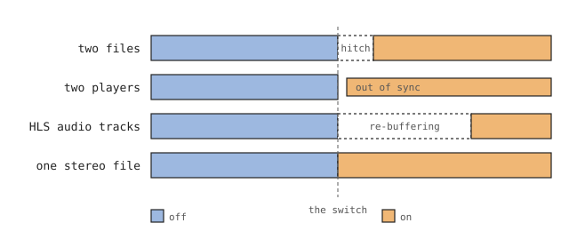
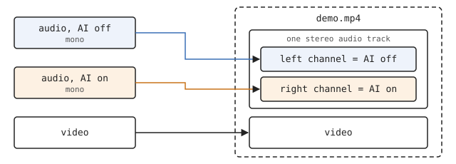
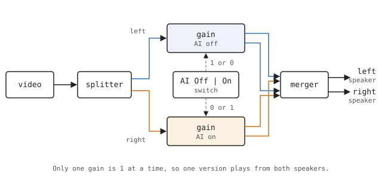
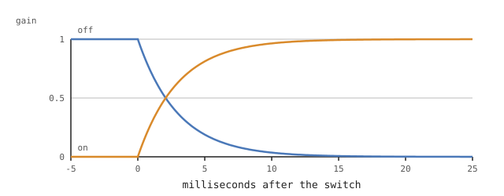

I recently did some contract work for Fortell, a company that makes hearing aids which use a neural network to pull speech out of background noise. The problem they came to me with was a simple one to state: how do you show someone on a website what it's like to put the hearing aids on?

The answer we wanted was a video of a noisy scene (a busy restaurant, for example) with a switch on it. Flip the switch, and you hear the scene the way the hearing aid would play it. Flip it back, and you hear it without. I built it, and Fortell is pursuing a patent on the approach with me as the inventor. They were kind enough to let me write about how it works.

## Why this is harder than it sounds

For a comparison like this to be convincing, the switch has to be instant. Our memory for exactly how something sounded is very short, so if there's a gap of even a second or two between the two versions, it's hard to say what changed. The video also can't pause, skip, or drift out of sync with the audio.

There are a few obvious ways to build this, and each has a problem.

1. Use two video files, one for each audio track. Switching means loading a different file and seeking to the same position, so there's a visible hitch. It also doubles the storage and the bandwidth, for a video that's identical in both.
2. Play two files at the same time and mute one. Two separate media elements don't stay perfectly aligned, especially on a slow connection, and the user is still downloading the video twice.
3. Use the alternate audio tracks that streaming formats like HLS support. This is what they're for, but switching between audio renditions involves re-buffering, which can take several seconds. That's fine for changing the language of a movie, and it's no good for an A/B comparison.



## The trick

The approach I ended up with relies on the fact that a stereo audio track is really two independent tracks that happen to be played in different ears. The hearing aid comparison doesn't need stereo, so we can use those two slots for something else: the "off" audio goes in the left channel, and the "on" audio goes in the right channel.

Preparing the file is one `ffmpeg` command:

```
ffmpeg -i scene.mp4 -i off.wav -i on.wav \
  -filter_complex "[1:a][2:a]join=inputs=2:channel_layout=stereo[a]" \
  -map 0:v -map "[a]" -c:v copy demo.mp4
```



The result is a perfectly ordinary video file. Both versions of the audio are inside it, and since they're part of the same track, they can't drift apart from each other or from the video.

Of course, if we played that file as-is, we would hear the unprocessed audio in one ear and the processed audio in the other. The second half of the trick is in the browser, using the Web Audio API. We split the stereo track back into its two channels, give each channel its own volume control, and connect _both_ of them to _both_ speakers:

```
const context = new AudioContext();
const source = context.createMediaElementSource(video);
const splitter = context.createChannelSplitter(2);
const merger = context.createChannelMerger(2);
const off = context.createGain();
const on = context.createGain();

source.connect(splitter);
splitter.connect(off, 0);
splitter.connect(on, 1);

for (const gain of [off, on]) {
  gain.connect(merger, 0, 0);
  gain.connect(merger, 0, 1);
}

merger.connect(context.destination);

const setEnhanced = (enabled) => {
  on.gain.value = enabled ? 1 : 0;
  off.gain.value = enabled ? 0 : 1;
};
```



This is a simplified sketch and not the production code, but it's the whole idea. One volume is at 1 and the other is at 0, so only one version is audible at a time, and it comes out of both speakers. Switching is just swapping those two numbers.

Nothing is loaded, buffered, or restarted when that happens. Both tracks are already decoded and flowing through the graph the entire time, and we're only choosing which one to listen to. The switch takes less than a millisecond, with no gap and no click, and the video never notices.

## A few details that matter

Match the loudness of the two tracks. If one version is even a little louder, it sounds "better" for that reason alone, and the comparison stops being a fair one. It also makes the switch jarring.

Build one audio graph and share it. A media element can only be attached to a Web Audio source once, and browsers aren't happy about a page that creates a lot of audio contexts. On a page with several demo videos, they all connect to the same graph, and one switch controls all of them.

Browsers won't start an audio context until the user has interacted with the page, so the graph has to be set up (or resumed) on the first click.

A sudden jump in volume can occasionally produce a faint click, depending on the audio. If that happens, ramping the two volumes in opposite directions over a few milliseconds fixes it, and it's still far too fast to notice.

Web Audio has this built in, so the change to the sketch above is small:

```
const setEnhanced = (enabled) => {
  const now = context.currentTime;
  on.gain.setTargetAtTime(enabled ? 1 : 0, now, 0.003);
  off.gain.setTargetAtTime(enabled ? 0 : 1, now, 0.003);
};
```

The last argument is a time constant, in seconds. Each volume gets most of the way to its new value within about 10 milliseconds, which is enough to smooth out the click and much too short to hear as a gap.



## The tradeoffs

Like everything, this has tradeoffs. The biggest one is that each version of the audio is mono, since we've spent the stereo channels on holding two tracks. For a hearing aid demo that's a reasonable price, and for a music video it wouldn't be.

The file also depends on the player. Anything that plays it without the routing code will put a different version in each ear, so it's not a file to hand out on its own. And two channels means two versions, unless you move to a surround format and its extra channels.

For what it's worth, the same approach should work anywhere that two versions of the same audio need to be compared against the same picture: before and after noise reduction on a podcast, a raw mix against a mastered one, or a video with and without audio description.

What I like the most about this solution is how little there is to it. The alternatives involve streaming servers and synchronization logic, and this one is a single file and about twenty lines of routing. Simplicity tends to be the hard part of the job, and this was a good reminder.
